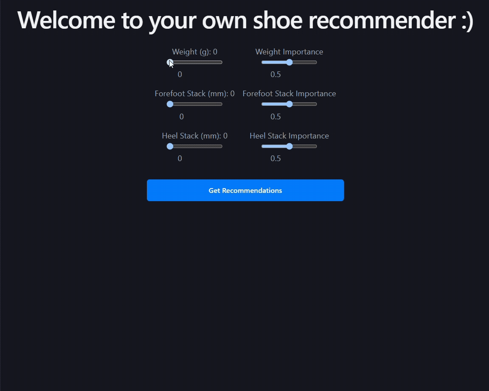

## Running Shoe Recommender
### Overview
Full-stack web app that recommends running shoes.

<p align="center">
  
</p>


### Requirements
* [Node.js](https://nodejs.org/en/download)
* [python >= 3.14](https://www.python.org/downloads/)
* [uv](https://docs.astral.sh/uv/getting-started/installation/)


### Running the App
1. Start the backend server.
```
cd backend/shoe-recommender
uv run uvicorn shoe_recommender.main:app --reload
```

2. Start the frontend server.
```
cd frontend/shoe-recommender
npm run dev
```

3. Go to [localhost:5173](http://localhost:5173/) to use the app. To view the API only, go to [localhost:8000/docs](http://localhost:8000/docs).


### How are Recommendations Generated?
This app uses content-based recommendation. I.e. shoes that are most similar to the user's preferences are recommended.
* User shoe preferences and shoes are represented as vectors based on key physical traits (i.e. weight, stack height)
* Distance between each shoe and the user vector is computed via weighted Manhattan distance
* Similarity score is computed by taking the inverse of the distance
